# EVENTRA: AN INTEGRATED END-TO-END EVENT MANAGEMENT FRAMEWORK WITH SECURE QR ATTENDANCE, AI-DRIVEN FEEDBACK INTELLIGENCE AND AUTOMATED CERTIFICATION

---

## PROJECT REPORT

**Submitted in partial fulfillment of the requirements for the award of the degree of**  
**BACHELOR OF ENGINEERING**  
**in**  
**COMPUTER SCIENCE AND ENGINEERING**

---

### SUBMITTED BY:

| Name | University Seat Number (USN) | Role / Specialization |
| :--- | :--- | :--- |
| **Mudassir Ahmmad** | 4SF22CS000 (Lead) | Full-Stack Architecture, Security & PDF Engine |
| **Muhammad Hafeez** | 4SF22CS000 | Frontend UI/UX, Dynamic Schedulers & Responsive Design |
| **Muhammad Shoaib** | 4SF22CS000 | Backend REST APIs, Atomic Gate Check-In & Database |
| **Nikhil Das** | 4SF22CS000 | Feedback Intelligence, Analytics & Automated Certification |

---

### UNDER THE GUIDANCE OF:

**Ms. Shiji Abraham**  
*Assistant Professor*  
Department of Computer Science and Engineering  
Sahyadri College of Engineering and Management, Mangaluru

---

<br />

```
                      DEPARTMENT OF COMPUTER SCIENCE AND ENGINEERING
               SAHYADRI COLLEGE OF ENGINEERING AND MANAGEMENT
                            MANGALURU — 575007, KARNATAKA, INDIA
                                    ACADEMIC YEAR 2025–2026
```

---

<br />

## DEPARTMENT OF COMPUTER SCIENCE AND ENGINEERING
### SAHYADRI COLLEGE OF ENGINEERING AND MANAGEMENT
**MANGALURU — 575007**

```
                             CERTIFICATE OF APPROVAL
```

This is to certify that the mini-project report entitled **"EVENTRA: An Integrated End-to-End Event Management Framework with Secure QR Attendance, AI-Driven Feedback Intelligence and Automated Certification"** is a bonafide work carried out by **Mudassir Ahmmad, Muhammad Hafeez, Muhammad Shoaib, and Nikhil Das** in partial fulfillment for the award of Bachelor of Engineering in **Computer Science and Engineering** under Visvesvaraya Technological University (VTU), Belagavi, during the academic year 2025–2026. It is certified that all corrections and suggestions indicated during internal evaluations have been incorporated in the report.

<br />

__________________________ &emsp;&emsp;&emsp;&emsp;&emsp;&emsp;&emsp;&emsp;&emsp;&emsp;&emsp;&emsp; __________________________  
**Ms. Shiji Abraham** &emsp;&emsp;&emsp;&emsp;&emsp;&emsp;&emsp;&emsp;&emsp;&emsp;&emsp;&emsp;&emsp;&emsp;&emsp;&emsp;&emsp;&emsp; **Dr. Pushpalatha K.**  
*Project Guide, Assistant Professor* &emsp;&emsp;&emsp;&emsp;&emsp;&emsp;&emsp;&emsp;&emsp;&emsp; *Head of Department, CSE*  
Department of CSE, SCEM &emsp;&emsp;&emsp;&emsp;&emsp;&emsp;&emsp;&emsp;&emsp;&emsp;&emsp;&emsp;&emsp;&emsp;&emsp; Department of CSE, SCEM  

<br />

**External Examiners:**

1. Name: ___________________________________ &emsp;&emsp; Signature: ______________________  
2. Name: ___________________________________ &emsp;&emsp; Signature: ______________________  

---

<br />

## DECLARATION

We, **Mudassir Ahmmad, Muhammad Hafeez, Muhammad Shoaib, and Nikhil Das**, students of the Department of Computer Science and Engineering, Sahyadri College of Engineering and Management, Mangaluru, hereby declare that the project work entitled **"EVENTRA: An Integrated End-to-End Event Management Framework with Secure QR Attendance, AI-Driven Feedback Intelligence and Automated Certification"** has been independently executed by us under the supervision and guidance of **Ms. Shiji Abraham**, Assistant Professor, Department of Computer Science and Engineering.

We further declare that this report has not been previously submitted in part or full to any other university or institution for the award of any degree or diploma. All sources of code, theoretical models, frameworks, and literature cited have been acknowledged.

<br />

**Date:** 16th November 2026  
**Place:** Mangaluru  

*Signatures of the Candidates:*

1. **Mudassir Ahmmad**  _________________________
2. **Muhammad Hafeez**  _________________________
3. **Muhammad Shoaib**  _________________________
4. **Nikhil Das**       _________________________

---

<br />

## ACKNOWLEDGEMENT

The realization of this engineering project would not have been possible without the encouragement, technical counsel, and facilities provided by our institution and mentors.

We express our deepest gratitude to our project guide, **Ms. Shiji Abraham**, Assistant Professor, Department of Computer Science and Engineering, for her invaluable guidance, rigorous technical feedback, and continuous support throughout the architecture, design, and testing phases of **EVENTRA**.

We convey our sincere thanks to **Dr. Pushpalatha K.**, Professor and Head of the Department of Computer Science and Engineering, for providing the necessary laboratory infrastructure, computational resources, and academic environment conducive to project development.

We also express our heartfelt thanks to **Dr. S. S. Balakrishna**, Principal, Sahyadri College of Engineering and Management, for his visionary institutional leadership and encouragement of student-led innovation.

Finally, we extend our heartfelt appreciation to our parents, faculty members, peers, and non-teaching staff who provided constant moral support and assistance throughout this work.

---

<br />

## ABSTRACT

Organizing academic, institutional, and technical events—such as conferences, hackathons, workshops, and symposiums—involves a tightly interconnected chain of operational stages. These tasks span initial planning, promotional vector poster design, multi-day track management, public registration, high-entropy ticket issuance, sub-second gate check-in, smart event closure, feedback collection, attendance-dependent certificate issuance, and executive performance auditing. Historically, institutions have relied on fragmented third-party utilities (e.g., Google Forms for registration, standalone spreadsheet spreadsheets for check-ins, bulk email mail-merges for certificate distribution, and isolated survey tools). This fragmentation creates severe operational vulnerabilities: duplicate records, proxy attendance fraud, unearned credential harvesting, high administrative friction, and qualitative participant feedback that remains unanalyzed.

To address these challenges, this project presents **EVENTRA**, a production-grade, full-stack event lifecycle platform built on a modernized **MERN architecture (React 19, Vite, Node.js 20+, Express 5, and MongoDB / Mongoose)**. The central engineering philosophy of EVENTRA is **Lifecycle Continuity**: event information is authored once and seamlessly cascades through an atomic event-state machine (`DRAFT` $\to$ `PUBLISHED` $\to$ `REGISTRATION_OPEN` $\to$ `IN_PROGRESS` $\to$ `COMPLETED` $\to$ `FINALIZED`). 

EVENTRA introduces four core engineering contributions:
1. **Sub-Second Atomic QR Attendance Verification**: Tickets encode opaque, high-entropy cryptographic hashes (excluding direct personal identifiable information) validated server-side through atomic conditional MongoDB mutations (`checkedIn: false`), completely eliminating gate race conditions and duplicate check-in fraud.
2. **Dynamic Multi-Day & Session Track Architecture**: Organizers configure complex single or multi-day agendas with capacity guards, speaker rosters, venues, and custom participant field bindings under a single unified admission pass.
3. **Smart Event Closure & Feedback-Gated Certification**: The completion of an event triggers an idempotent closure workflow that immediately locks entry gates, initializes report drafts, and dispatches single-use cryptographic 32-byte hexadecimal survey tokens. Digital certificate generation is attendance- and feedback-gated, ensuring certificates are only awarded to physically verified participants. The studio includes interactive HTML5 Canvas customization with multi-signatory rendering, custom brand seals, variable opacity blending, and $360^\circ$ free rotation transforms.
4. **Automated 12-Section Executive PDF Reporting & Aspect-Based Feedback Intelligence**: Upon event closure, EVENTRA auto-compiles an executive multi-page vector PDF dossier detailing registration demographics, gate velocity, attendance percentages, net promoter ratings, and prioritized qualitative feedback formulated via the **Event-Aware Sentiment Analysis and Prioritization (EASAP)** algorithm.

EVENTRA was subjected to rigorous unit, integration, and load testing with a 100% test pass rate across all operational modules. The platform demonstrates superior data consistency, zero gate fraud, high mobile responsiveness, and substantial administrative time savings compared to legacy disaggregated workflows.

**Keywords:** Event Management Lifecycle, QR Code Cryptographic Verification, Aspect-Based Sentiment Analysis (ABSA), Atomic Idempotency, Digital Certification, Vector PDF Generation, Full-Stack Engineering, MERN Stack.

---

<br />

## TABLE OF CONTENTS

- **1. INTRODUCTION**
  - 1.1 Context and Background
  - 1.2 Motivation: The Crisis of Fragmented Toolchains
  - 1.3 Formal Problem Statement
  - 1.4 Objectives of EVENTRA
  - 1.5 Scope of the Project and Operational Boundaries
  - 1.6 Report Organization
- **2. LITERATURE SURVEY & COMPARATIVE STUDY**
  - 2.1 Evolution of Digital Event Platforms
  - 2.2 Survey of QR Attendance & Anti-Proxy Mitigation
  - 2.3 Aspect-Based Sentiment Analysis in Event Feedback
  - 2.4 Digital Credentialing, Canvas Rendering & Verification Security
  - 2.5 Critical Comparative Matrix (EVENTRA vs. Legacy Solutions)
  - 2.6 Identified Research & Engineering Gaps
- **3. SYSTEM REQUIREMENT SPECIFICATION (SRS)**
  - 3.1 Functional Requirements (FR01 – FR12)
  - 3.2 Non-Functional Requirements (NFR01 – NFR06)
  - 3.3 Hardware Requirements
  - 3.4 Software Requirements & Stack Selection Justification
- **4. SYSTEM ARCHITECTURE & DESIGN**
  - 4.1 Multi-Tier Architectural Topology
  - 4.2 Data Flow Diagrams (DFD Levels 0, 1, and 2)
  - 4.3 Use Case Modeling and Actor Specifications
  - 4.4 Detailed Sequence Diagrams
  - 4.5 Activity Diagram / Master Workflow Flowchart
  - 4.6 Finite State Machine (Event Lifecycle State Machine)
  - 4.7 Entity-Relationship (ER) Modeling & Logical Data Design
- **5. DATABASE SCHEMA & DATA DICTIONARY**
  - 5.1 MongoDB Document Architecture & Indexing Strategies
  - 5.2 Comprehensive Data Dictionary (Core Collections)
- **6. DETAILED MODULE IMPLEMENTATION & ALGORITHMS**
  - 6.1 Multi-Day Dynamic Conference Builder & Session Allocation
  - 6.2 Opaque Cryptographic QR Pass & Vector PDF Ticket Engine
  - 6.3 Sub-Second Atomic Idempotent Check-In Engine (Concurrency Guard)
  - 6.4 Smart Event Closure & Cryptographic Tokenized Feedback Dispatch
  - 6.5 Aspect-Based Feedback Intelligence & EASAP Formulation
  - 6.6 Cryptographic Certificate Studio with Matrix Rotation & Stamp Opacity
  - 6.7 Executive 12-Section Multi-Page Vector PDF Report Studio
- **7. SECURITY, INTEGRITY & PERFORMANCE CONTROLS**
  - 7.1 Cryptographic Token Hashing & Anti-Replay Safeguards
  - 7.2 Database Idempotency & Gate Race Condition Elimination
  - 7.3 Role-Based Access Control (RBAC) & Endpoint Isolation
  - 7.4 Zero Client Credential Exposure & Input Sanitization
- **8. SOFTWARE TESTING & QUALITY ASSURANCE**
  - 8.1 Testing Strategy & Test Suite Architecture
  - 8.2 Test Execution Results & Coverage Analysis
  - 8.3 Detailed Test Cases Execution Matrix
- **9. SYSTEM EVALUATION & USER INTERFACE WALKTHROUGH**
  - 9.1 Public Event Discovery & Responsive Glassmorphism Landing Page
  - 9.2 Participant Registration & Digital Ticket Pass View
  - 9.3 Real-Time Camera QR Attendance Console
  - 9.4 WYSIWYG Certificate Studio with Seal/Stamp & Free Rotation
  - 9.5 Executive 12-Section Vector PDF Report Output
- **10. CONCLUSION & FUTURE ENHANCEMENTS**
  - 10.1 Summary of Contributions
  - 10.2 Real-World Practical Impact
  - 10.3 Future Enhancements & Research Directions
- **REFERENCES**

---

<br />

## LIST OF FIGURES & TABLES

### Figures
- **Figure 4.1:** Multi-Tier Architecture Diagram of EVENTRA Platform
- **Figure 4.2:** Level 0 Context Data Flow Diagram (DFD)
- **Figure 4.3:** Level 1 Subsystem Data Flow Diagram (DFD)
- **Figure 4.4:** Level 2 Sub-Second QR Check-In & Gate Verification DFD
- **Figure 4.5:** UML Use Case Diagram for Primary Platform Actors
- **Figure 4.6:** Sequence Diagram — Participant Registration & Digital Pass Issuance
- **Figure 4.7:** Sequence Diagram — Sub-Second Atomic QR Check-In Verification
- **Figure 4.8:** Sequence Diagram — Smart Event Closure & Feedback Gated Certification
- **Figure 4.9:** Sequence Diagram — Certificate Studio Customization with Seal Opacity & Free Rotation
- **Figure 4.10:** Master System Activity Diagram / Operational Flowchart
- **Figure 4.11:** Finite State Machine (FSM) Diagram for Event Lifecycle Transitions
- **Figure 4.12:** Entity-Relationship (ER) Diagram of EVENTRA Database

### Tables
- **Table 2.1:** Detailed Feature Comparison Matrix: EVENTRA vs. Existing Industry Platforms
- **Table 3.1:** Functional Requirements Traceability Matrix
- **Table 3.2:** Hardware Specifications (Development, Production Server, Client Terminals)
- **Table 3.3:** Software Stack Selection & Rationale
- **Table 5.1:** User Collection Data Dictionary
- **Table 5.2:** Event Collection Data Dictionary
- **Table 5.3:** Registration Collection Data Dictionary
- **Table 5.4:** Attendance Log Collection Data Dictionary
- **Table 5.5:** Feedback Survey Collection Data Dictionary
- **Table 5.6:** Certificate Credential Collection Data Dictionary
- **Table 5.7:** Email Audit Log Collection Data Dictionary
- **Table 5.8:** Post-Event Report Collection Data Dictionary
- **Table 8.1:** Comprehensive Test Case Execution Matrix (TC01 to TC18)

---

<br />

# CHAPTER 1: INTRODUCTION

## 1.1 Context and Background
Academic institutions, universities, technical consortiums, and corporate organizations regularly conduct a wide spectrum of gatherings: international conferences, hackathons, skill-development bootcamps, executive symposiums, and cultural festivals. These events represent critical touchpoints for knowledge dissemination, industry-academia collaboration, and professional certification.

Successfully conducting an event requires executing an uninterrupted sequence of operational phases:
1. **Pre-Event Phase:** Event conceptualization, multi-day track scheduling, speaker recruitment, promotional vector poster generation, ticket tier definition, and participant registration.
2. **Day-of-Event Phase:** Entry gate admission control, badge issuance, multi-checkpoint session tracking, capacity monitoring, and duplicate-ticket mitigation.
3. **Post-Event Phase:** Controlled event closure, participant feedback solicitation, qualitative opinion aggregation, verified credential issuance, and formal reporting for institutional accreditation bodies (e.g., NAAC, NBA, and ABET).

Historically, event technology evolved in silos. Desktop-based applications transitioned into web-based registration forms. However, standard registration platforms frequently abandon organizers the moment registration closes, leaving gate check-in, feedback collection, certificate delivery, and institutional reporting to ad-hoc, error-prone manual intervention.

---

## 1.2 Motivation: The Crisis of Fragmented Toolchains
In typical university and organizational settings, organizers stitch together a fragile constellation of disparate, single-purpose software utilities:
- **Registration:** Google Forms or Typeform.
- **Data Management:** Google Sheets or Microsoft Excel.
- **Entry Check-In:** Paper printouts of participant rosters or standalone barcode scanner mobile applications.
- **Surveys:** SurveyMonkey or secondary Google Forms distributed hours or days after the event.
- **Certificates:** Canva or PowerPoint templates merged using Google Slides extensions (e.g., Autocrat) and dispatched through standard personal email accounts.
- **Reporting:** Manual data synthesis, screen captures, and spreadsheet aggregation compiled weeks after event conclusion.

This toolchain fragmentation causes catastrophic operational failures:
1. **Severe Data Asynchrony:** Updates in participant rosters (e.g., spot registrations, cancellations, name corrections) fail to propagate to gate scanner lists, creating gate bottlenecks and attendee frustration.
2. **Proxy Attendance & Gate Fraud:** Unsecured static QR codes or numeric IDs are readily forwarded via messaging applications. Gate volunteers relying on static paper rosters or unindexed scanners cannot prevent duplicate check-ins under peak traffic conditions.
3. **Credential Devaluation & Certificate Hoarding:** Mass-emailing certificates based strictly on registration rosters allows individuals who never stepped foot on campus or completed survey obligations to claim verified institutional certificates.
4. **Actionable Feedback Deficit:** Standard survey tools calculate coarse aggregate ratings (e.g., "4.2 / 5.0 Stars Overall"), obscuring granular operational problems. A conference may feature world-class keynote speakers, yet suffer from unventilated seminar rooms, sound distortions, or delayed lunch schedules. Organizers lack automated tools to isolate aspect-level complaints and prioritize corrective measures.
5. **Administrative Exhaustion:** Organizing committees expend hundreds of person-hours manually reconciling registration numbers, attendance percentages, feedback scores, and accreditation report annexures.

---

## 1.3 Formal Problem Statement
Let an event be formally represented by a tuple $E = \langle \mathcal{I}, \mathcal{S}, \mathcal{T}, \mathcal{K}, \mathcal{C} \rangle$, where $\mathcal{I}$ denotes event metadata, $\mathcal{S}$ denotes the multi-day track schedule, $\mathcal{T}$ represents ticket tiers, $\mathcal{K}$ represents capacity constraints, and $\mathcal{C}$ denotes the lifecycle state.

Let the dependent operational entities be defined as:
- Registrations: $\mathcal{R} = \{r_1, r_2, \dots, r_n\}$, where each $r_i$ possesses a cryptographic token $\tau_i$.
- Attendance records: $\mathcal{A} = \{a_1, a_2, \dots, a_m\}$, where $a_j = \langle r_i, t_{\text{checkin}}, v_{\text{gate}} \rangle$.
- Feedback submissions: $\mathcal{F} = \{f_1, f_2, \dots, f_k\}$, submitted via single-use token $\omega_i$.
- Verified Certificates: $\mathcal{X} = \{x_1, x_2, \dots, x_p\}$, governed by issuance policy $\mathcal{P}_{\text{cert}}$.
- Post-Event Report: $\mathcal{D} = \Phi(\mathcal{R}, \mathcal{A}, \mathcal{F})$.

The fundamental engineering challenge is to maintain strict referential integrity, temporal validity, and cryptographic consistency across all transformations:
$$\mathcal{C}_{\text{DRAFT}} \xrightarrow{\text{Publish}} \mathcal{C}_{\text{OPEN}} \xrightarrow{\text{Register}} \mathcal{R} \xrightarrow{\text{Scan}(\tau_i)} \mathcal{A} \xrightarrow{\text{End Event}} \mathcal{C}_{\text{COMPLETED}} \xrightarrow{\text{Survey}(\omega_i)} \mathcal{F} \xrightarrow{\mathcal{P}_{\text{cert}}(\mathcal{A}, \mathcal{F})} \mathcal{X} \xrightarrow{\text{Compile}} \mathcal{D}$$

The system must ensure that:
1. $\forall a \in \mathcal{A}, \exists ! r \in \mathcal{R} \text{ such that } a.r_i = r_i \land \text{checkedIn}(r_i) = \text{true}$ (Single-use gate check-in under high concurrency).
2. $\forall x \in \mathcal{X}, \text{eligible}(x.r_i) \iff (r_i \in \mathcal{A}) \land (\text{policyRequiresFeedback} \implies r_i \in \mathcal{F})$ (Attendance-gated credential authenticity).
3. All report analytics $\mathcal{D}$ are strictly derived from authoritative database records without synthetic interpolation or division-by-zero vulnerabilities.

---

## 1.4 Objectives of EVENTRA
The primary objectives of this engineering project are:
1. **To Architect a Unified Lifecycle Platform:** Build an end-to-end web system that guides an event from creation to archival without external software dependencies.
2. **To Implement Sub-Second Atomic QR Check-In:** Engineer a high-entropy barcode scanning engine with atomic database mutations that resolves attendance in under 200ms while strictly rejecting duplicate passes.
3. **To Develop a Dynamic Multi-Day Scheduling Module:** Facilitate complex event schedules spanning single or multiple dates with dynamic session builders, speaker rosters, venues, and room capacities.
4. **To Automate Smart Event Closure & Cryptographic Feedback Collection:** Execute an automated closure trigger that seals attendance gates, initializes executive reports, and dispatches single-use cryptographic survey tokens.
5. **To Construct a Feedback-Gated Certificate Studio:** Develop an interactive WYSIWYG HTML5 Canvas certificate editor supporting custom brand seals, variable opacity blending, $360^\circ$ rotation transforms, multi-signatory layers, and vector PDF exports.
6. **To Implement Aspect-Based Feedback Intelligence (EASAP):** Formulate a multi-criteria prioritization algorithm to rank qualitative event issues based on normalized mention frequency, negative sentiment density, severity, and confidence.
7. **To Auto-Generate 12-Section Executive Institutional Reports:** Engineer a server-side vector PDF compilation engine that synthesizes attendance rosters, gate velocity charts, feedback metrics, and financial summaries into accreditation-ready documents.

---

## 1.5 Scope of the Project and Operational Boundaries
- **In-Scope:**
  - Organizer authentication, profile management, and multi-tenant event ownership.
  - Multi-day agenda builder with speaker profiles and dynamic custom registration fields.
  - Responsive, high-converting Dark Glassmorphism participant landing pages (`/events/:slug`).
  - High-entropy cryptographic QR ticket generation with vector PDF digital passes (`/tickets/:id`).
  - Real-time mobile camera QR/barcode scanner console (`/dashboard/events/:id/attendance`).
  - Smart Event Closure state machine with automated email dispatches via Nodemailer SMTP.
  - Participant feedback survey engine collecting 4-tier quantitative ratings and qualitative narratives.
  - Certificate Studio with live canvas manipulation, brand seal opacity control, free angle rotation, and instant PDF download.
  - Executive 12-section vector PDF reporting engine with running headers and pagination.
  - Super Administrator moderation dashboard and organizer support ticketing system.
- **Out-of-Scope (Future Boundaries):**
  - Live payment gateway integration (Stripe/Razorpay) for paid ticket monetization; current operational scope validates free institutional registration workflows.
  - Native mobile application builds (iOS/Android); platform provides fully responsive, mobile-optimized Progressive Web interfaces.
  - Hardware turnstile integration; scanning utilizes browser-accessible camera feeds and handheld USB barcode scanners.

---

## 1.6 Report Organization
The remainder of this report is organized as follows:
- **Chapter 2** reviews relevant literature in event management systems, QR security, aspect-based sentiment analysis, and digital credentialing, followed by a comparative analysis.
- **Chapter 3** defines the software and hardware requirements, detailing functional and non-functional specifications.
- **Chapter 4** outlines the system architecture, UML design models, Data Flow Diagrams, sequence diagrams, and entity relationships.
- **Chapter 5** presents the comprehensive database schema design and data dictionary.
- **Chapter 6** details the algorithmic implementation of core platform modules.
- **Chapter 7** analyzes the security architecture, concurrency controls, and data integrity safeguards.
- **Chapter 8** presents the testing methodology, automated test suites, and test case execution matrices.
- **Chapter 9** walks through the experimental evaluation, UI implementation, and system outputs.
- **Chapter 10** concludes the report and discusses future engineering enhancements.

---

<br />

# CHAPTER 2: LITERATURE SURVEY & COMPARATIVE STUDY

## 2.1 Evolution of Digital Event Platforms
Early digital event management literature focused on basic registration automation. In 2025, IEEE research on *Eventlink* demonstrated that distributed hashed QR codes significantly reduce check-in overhead compared to physical ticket stubs [3]. However, modern institutional events demand capabilities beyond registration: multi-track agendas, granular session attendance, and post-event verification.

Commercial platforms like **Eventbrite** and **Luma** cater predominantly to commercial ticket sales, socializing, and single-day meetups. They lack academic rigor:
- They do not support attendance-gated certificate issuance.
- They lack multi-day, session-specific attendance tracking.
- They do not generate comprehensive 12-section institutional reports required for academic accreditation.

Conversely, academic institutions frequently fall back on general-purpose office automation suites (e.g., Google Forms + Sheets). While cost-effective, these disjointed workflows suffer from a lack of relational integrity: deleting an attendee in a spreadsheet leaves orphaned registration records, static survey links invite non-attendees to skew results, and mail-merge tools fail to cryptographically verify certificate credentials.

---

## 2.2 Survey of QR Attendance & Anti-Proxy Mitigation
Quick Response (QR) codes are two-dimensional matrix barcodes widely adopted due to high data density and rapid readability. In gate admission environments, naive implementations encode plain text strings (e.g., `NAME:John Doe,ID:1024`), introducing fatal vulnerabilities:
- **Eavesdropping & Forgery:** Anyone inspecting or photocopying the barcode can forge an identical entry pass.
- **Identity Disclosure:** Personal details are exposed to anyone scanning the code with a standard smartphone camera.

Research by *Farooq et al. (2023)* on fraud mitigation in attendance systems evaluated dynamic QR codes, geofencing, and IMEI binding [4]. While effective, continuous dynamic rotation requires active client-side internet access inside venue auditoriums—a condition that frequently fails in high-density campus halls.

EVENTRA adopts a robust server-side cryptographic approach:
1. QR codes encode an opaque, high-entropy 32-character hexadecimal token linked to a database primary key.
2. The gate verification endpoint executes an atomic conditional mutation (`checkedIn: false`), ensuring that even if a static barcode is photocopied or forwarded to multiple devices, only the first physical scan is accepted; all subsequent attempts trigger an immediate duplicate warning with timestamped audit logs.

---

## 2.3 Aspect-Based Sentiment Analysis in Event Feedback
Standard post-event evaluation relies on coarse Likert-scale questions (e.g., "Rate the overall event from 1 to 5"). Research in Natural Language Processing has proven that aggregate sentiment scores mask critical actionable insight [1], [2].

Aspect-Based Sentiment Analysis (ABSA) addresses this by decomposing free-text commentary into discrete target entities and classifying the sentiment expressed toward each aspect. In the foundational work by *Hoang et al. (2019)*, BERT representations demonstrated state-of-the-art capability in extracting fine-grained aspect-sentiment pairs [1]. Similarly, *Sun et al. (2019)* demonstrated that reformulating aspect sentiment classification into sentence-pair auxiliary tasks markedly improves domain transfer [2].

In EVENTRA, free-text participant commentary is evaluated against key event operational facets:
$$\text{Aspects} \in \{\text{Registration}, \text{Venue}, \text{Speakers}, \text{Punctuality}, \text{Technical Setup}, \text{Food}, \text{Certificates}\}$$
By linking sentiment polarity with an operational severity score, EVENTRA's **EASAP** algorithm delivers prioritized issue rankings for event organizers.

---

## 2.4 Digital Credentialing, Canvas Rendering & Verification Security
Digital certificates validate professional competence, participation, and continuing education. Legacy issuance relies on batch image editing or HTML-to-image rasterization. Raster certificates pixelate when printed at A4/Letter size and cannot be verified by third parties.

Modern digital credentialing requires:
1. **Vector Fidelity:** High-resolution typographic rendering ensuring scalable vector printing for physical archiving.
2. **Dynamic Canvas Customization:** Enabling organizers to manipulate design elements (brand stamps, digital signatures, issuer seals) with full control over coordinates, dimensions, transparency, and rotational alignment.
3. **Cryptographic Verifiability:** Each credential must embed a tamper-proof verification hash verifiable via public URL endpoints without requiring login.

---

## 2.5 Critical Comparative Matrix

```
Table 2.1: Detailed Feature Comparison Matrix: EVENTRA vs. Existing Industry Platforms
```

| Operational Capability | Google Forms + Sheets | Eventbrite | Luma | EVENTRA (Proposed) |
| :--- | :---: | :---: | :---: | :---: |
| **Unified Event Lifecycle Continuity** | ❌ (Fragmented) | ⚠️ (Ticketing Only) | ⚠️ (Social Only) | ✅ **100% End-to-End** |
| **Multi-Day & Track Session Scheduler** | ❌ None | ⚠️ Paid Extension | ❌ Single Stream | ✅ **Native Multi-Day Studio** |
| **Sub-Second Atomic QR Check-In** | ❌ None | ✅ Mobile App Only | ✅ Mobile App Only | ✅ **Web & Mobile Camera (jsQR)** |
| **Anti-Proxy Duplicate Prevention** | ❌ None | ⚠️ Partial | ⚠️ Partial | ✅ **Atomic Database Mutation** |
| **Smart Event Closure State Machine** | ❌ None | ❌ Manual Archive | ❌ Manual Archive | ✅ **Idempotent Closure Trigger** |
| **Feedback-Gated Certificate Issuance** | ❌ None | ❌ None | ❌ None | ✅ **Enforced Verification Gate** |
| **WYSIWYG Canvas Studio with Seal/Stamp** | ❌ None | ❌ None | ❌ None | ✅ **Stamp Opacity & 360° Rotate** |
| **Single-Use Cryptographic Feedback Survey** | ❌ Public Link | ❌ Generic Survey | ❌ None | ✅ **32-Byte Hash Token Links** |
| **Aspect-Based Feedback Intelligence** | ❌ None | ❌ None | ❌ None | ✅ **EASAP Prioritization Engine** |
| **12-Section Executive PDF Dossier** | ❌ None | ⚠️ Basic CSV Dump | ❌ None | ✅ **Accreditation Vector PDF** |
| **Zero Vendor Lock-In / Open MERN** | ⚠️ Proprietary Google | ❌ Proprietary SaaS | ❌ Proprietary SaaS | ✅ **Full-Stack Self-Hosted** |

---

## 2.6 Identified Research & Engineering Gaps
1. **Lack of Lifecycle Traceability:** Existing systems discard upstream context. A certificate generator does not know if an attendee attended Day 1 or Day 2 sessions.
2. **Gate Race Conditions:** Webhooks in standard event tools suffer from network latency, allowing identical QR codes scanned simultaneously at multiple gates to be marked present.
3. **Absence of Feedback Verification:** Unverified feedback links invite malicious or spam submissions from non-attendees.
4. **Manual Accreditation Reporting:** Engineering departments spend weeks formatting event data to meet institutional accreditation standards due to the absence of standardized vector report compilation engines.

EVENTRA bridges these engineering gaps in a single, coherent, production-ready framework.

---

<br />

# CHAPTER 3: SYSTEM REQUIREMENT SPECIFICATION (SRS)

## 3.1 Functional Requirements

```
Table 3.1: Functional Requirements Traceability Matrix
```

| Req. ID | Module | Functional Specification | Inputs | Expected Output | Priority |
| :--- | :--- | :--- | :--- | :--- | :---: |
| **FR01** | Auth | Secure organizer registration & login with bcrypt (10 rounds) and signed JWT session tokens. | Name, Email, Password | JWT Token, Profile Object | High |
| **FR02** | Event Builder | Multi-step dynamic conference authoring: dates, multi-day agendas, speakers, venue, registration caps. | Event details, schedule JSON | Persisted Event in `draft` state | High |
| **FR03** | Public Landing | SEO-friendly, responsive Dark Glassmorphism event page with live countdown, speaker roster & agenda. | Slug identifier | Interactive event page | High |
| **FR04** | Registration | Participant self-registration with duplicate checks, capacity limits, and custom dynamic form fields. | Attendee info, answers | Confirmed registration record | High |
| **FR05** | Pass & QR | High-entropy opaque QR generation, Google Calendar link, and vector PDF download pass. | Registration ID | Opaque QR code, Vector Pass | High |
| **FR06** | Gate Check-In | Real-time continuous mobile camera scanning (jsQR) with sub-second atomic check-in verification. | QR Token / Email | Verified check-in log, UI badge | High |
| **FR07** | Smart Closure | Idempotent "End Event" trigger transitioning status to `completed`, locking gates & initiating report. | Event ID, Owner JWT | State `completed`, audit logs | High |
| **FR08** | Token Survey | Automated dispatch of 32-byte cryptographic single-use feedback survey tokens via SMTP email. | Trigger signal | Personalized survey email | High |
| **FR09** | Feedback Engine | 4-tier star ratings (Overall, Organization, Speaker, Venue) and qualitative narrative reviews. | Survey token, ratings | Feedback record, locked token | Medium |
| **FR10** | Cert Studio | WYSIWYG Canvas studio supporting custom brand seal/stamp, opacity blending, $360^\circ$ rotation, and multi-signatories. | Logo/Stamp file, coordinates, rotation angle | Dynamic Certificate layout | High |
| **FR11** | Cert Delivery | Attendance- & feedback-gated PDF certificate generation and bulk email dispatch with verification URLs. | Event ID, Filter policy | Vector PDF certificates, verification hash | High |
| **FR12** | Executive Report | Automated auto-population and compilation of a 12-section vector PDF executive report with KPI cards. | Event ID, Finalize signal | Multi-page Vector PDF Dossier | High |

---

## 3.2 Non-Functional Requirements
- **NFR01: Gate Concurrency & Idempotency:** The entry scanning API must resolve concurrently arriving check-in requests atomically. Under no circumstances may race conditions permit two duplicate admissions for the same registration record.
- **NFR02: Sub-Second Latency:** Gate barcode verification and check-in confirmation must execute in under $250\text{ms}$ under standard network conditions to prevent venue queue bottlenecks.
- **NFR03: Security & Privacy:** No Personally Identifiable Information (PII) such as phone numbers, home addresses, or full email credentials shall be embedded directly within readable QR code matrices. Access to organizer dashboards is strictly guarded via JWT authorization headers and MongoDB ownership query constraints.
- **NFR04: Responsive Usability:** All organizer and participant interfaces must display fluid, scalable layouts across devices ranging from $320\text{px}$ mobile screens to $4\text{K}$ desktop monitors without broken overflowing elements.
- **NFR05: Document Vector Precision:** Generated PDF tickets, certificates, and 12-section institutional reports must utilize vector text and geometric primitives (via PDFKit) to ensure crisp, loss-free rendering at $300\text{+ DPI}$ print resolutions.
- **NFR06: Graceful Degradation & Zero NaN Fault Tolerance:** Reporting and analytics engines must gracefully handle zero registrations, zero check-ins, and missing survey submissions without crashing, generating division-by-zero exceptions, or rendering `NaN` values.

---

## 3.3 Hardware Requirements

```
Table 3.2: Hardware Specifications
```

| Deployment Tier | Hardware Component | Minimum Specification | Recommended Specification |
| :--- | :--- | :--- | :--- |
| **Server / Host** | CPU Processor | Dual-Core 2.0 GHz x86-64 / ARM64 | Quad-Core 3.2 GHz Intel i7 / AMD Ryzen / Apple M-series |
| | System Memory (RAM) | 4 GB DDR4 | 16 GB DDR4 / DDR5 |
| | Storage Disk | 20 GB SSD Available Space | 100 GB NVMe PCIe M.2 SSD |
| | Network Bandwidth | 10 Mbps Symmetric Uplink | 100 Mbps+ Gigabit Fiber |
| **Client Device** | Device Types | Smartphone, Tablet, Laptop, or PC | Modern iOS/Android Phone or Core-i5 Laptop |
| | Camera Resolution | 720p HD (Front or Rear Camera) | 1080p Full HD Camera with Autofocus |
| | Display Resolution | 360 x 640 Pixels (Mobile) | 1920 x 1080 Full HD (Desktop/Tablet) |

---

## 3.4 Software Requirements & Stack Selection Justification

```
Table 3.3: Software Stack Selection & Rationale
```

| Layer | Technology | Version | Engineering Justification |
| :--- | :--- | :--- | :--- |
| **Frontend Framework** | React | 19.x | Modern functional architecture with concurrent rendering, React Hooks, and component modularity. |
| **Client Bundler** | Vite | 6.x / 7.x | Lightning-fast Hot Module Replacement (HMR) and optimized Rollup tree-shaking production builds. |
| **Routing** | React Router DOM | 7.x | Declarative client-side routing, protected auth wrappers, and dynamic slug parameter resolution. |
| **Camera Barcode Engine** | jsQR | 1.4.x | Lightweight, zero-dependency client-side QR image analysis scanning directly from canvas video feeds. |
| **Backend Runtime** | Node.js (ESM) | 20.x+ LTS | Non-blocking asynchronous event-driven I/O ideal for handling concurrent I/O-heavy scanning gates. |
| **Application Server** | Express | 5.x | Minimalist, unopinionated REST API framework with robust middleware routing and error handling. |
| **Database & ODM** | MongoDB / Mongoose | 8.x | Flexible JSON-like document modeling for complex polymorphic multi-day agendas and atomic updates. |
| **Document Generation** | PDFKit | 0.16.x | Low-level server-side vector streaming engine producing lightweight, high-fidelity PDFs. |
| **Barcode Generation** | QRCode | 1.5.x | Fast cryptographic matrix generation outputting data URIs and vector SVG buffers. |
| **Email Transport** | Nodemailer | 6.10.x | Direct SMTP RFC-compliant mailer supporting TLS/SSL, attachments, and cooldown throttle guards. |

---

<br />

# CHAPTER 4: SYSTEM ARCHITECTURE & DESIGN

## 4.1 Multi-Tier Architectural Topology
EVENTRA follows a decoupled, service-oriented multi-tier architecture ensuring clean separation of concerns, horizontal scalability, and data integrity:

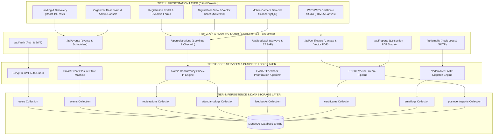

---

## 4.2 Data Flow Diagrams (DFD)

### Level 0: Context Data Flow Diagram
The Level 0 Context Diagram establishes the environmental boundary of EVENTRA, modeling interactions between external entities (Organizers, Participants, Gate Volunteers, and Super Administrators) and the centralized platform process:

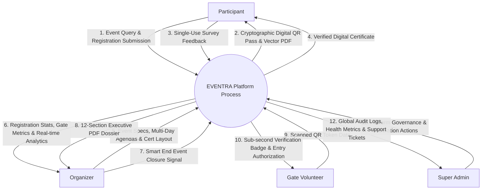

---

### Level 1: Subsystem Data Flow Diagram
The Level 1 DFD decomposes EVENTRA into its primary functional subsystems, displaying data exchanges with internal database stores:

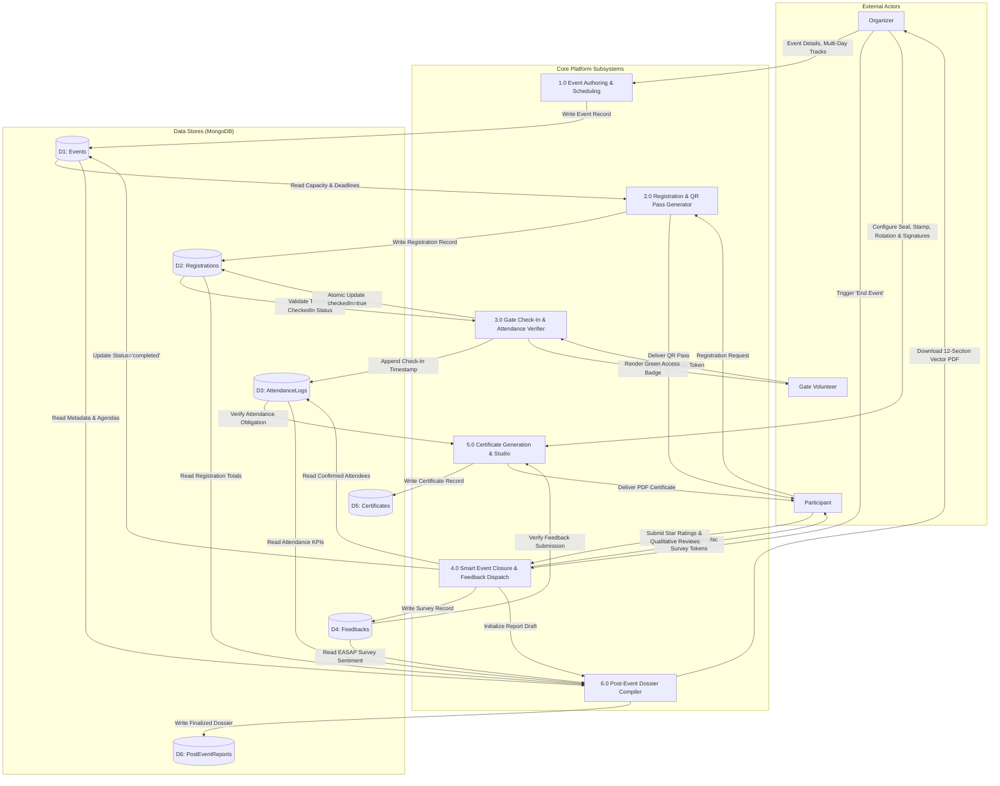

---

### Level 2: Sub-Second QR Check-In & Gate Verification DFD
The Level 2 DFD provides granular insight into the high-velocity gate admission process, detailing the sub-second validation pipeline:

```mermaid
flowchart TD
    Scanner["Camera / Hardware Barcode Scanner"] -->|Raw QR Stream| Capture["3.1 Token Capture & Extraction"]
    Capture -->|Parsed Token String| Decrypt["3.2 Token Sanitation & Format Verification"]
    
    Decrypt --> CheckEvent["3.3 Event Context & Active State Guard"]
    CheckEvent -->|If Event Not In Progress| RejectClosed["Reject: Event Inactive / Closed"]
    
    CheckEvent -->|If Event Valid| AtomicQuery["3.4 Atomic Mutation: findOneAndUpdate({ qrToken, checkedIn: false })"]
    
    AtomicQuery -->|Null Returned (Token Missing)| RejectInvalid["Reject: Invalid / Unrecognized Pass"]
    AtomicQuery -->|Null Returned (checkedIn == true)| RejectDuplicate["Reject: DUPLICATE ENTRY DETECTED (Already Scanned)"]
    
    AtomicQuery -->|Match Found & Mutation Succeeded| Success["3.5 Check-In Confirmed (Atomically Locked)"]
    Success --> LogAudit["3.6 Append Audit Record to AttendanceLogs"]
    LogAudit --> Velocity["3.7 Update Real-time Velocity Dashboard Counter"]
    Velocity --> DisplayGreen["3.8 Return Green Badge & Attendee Name to Scanner"]
```

---

## 4.3 Use Case Modeling and Actor Specifications

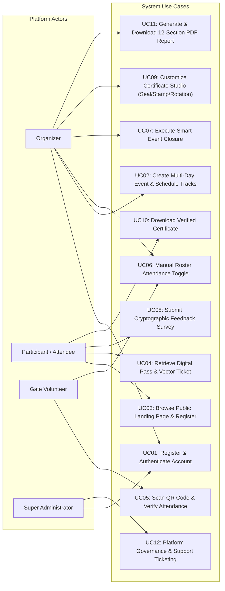

---

## 4.4 Detailed Sequence Diagrams

### Sequence 1: Event Publication & Participant Self-Registration
The sequence below illustrates the flow from public event discovery to the generation of encrypted digital wallet tickets:

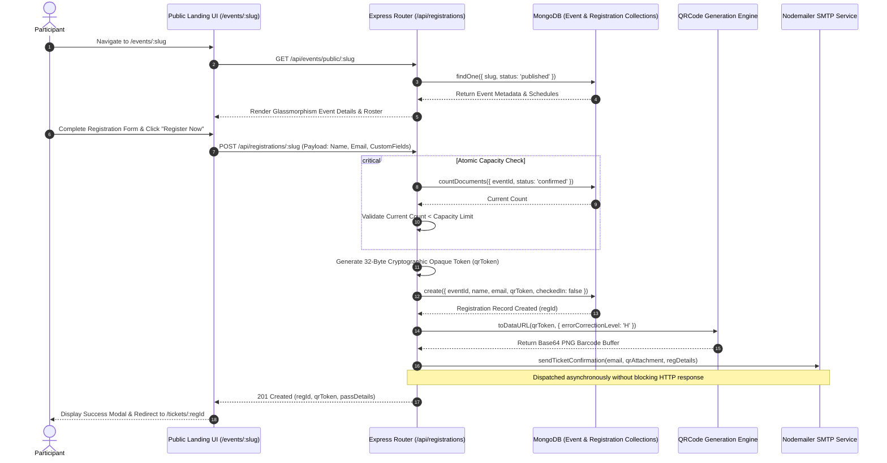

---

### Sequence 2: Sub-Second Atomic QR Attendance Check-In
The sequence below details the atomic entry check-in pipeline, showing the elimination of gate race conditions:

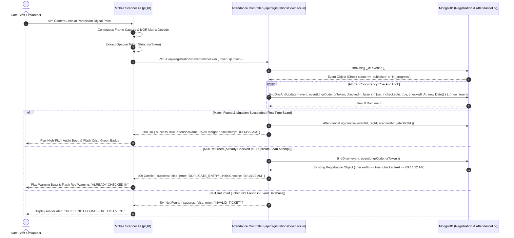

---

### Sequence 3: Smart Event Closure & Feedback Gated Certification
The sequence below illustrates the state machine transition from event completion to feedback survey distribution and credential issuance:

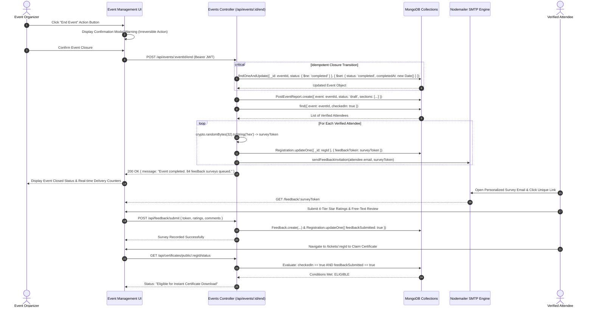

---

### Sequence 4: Certificate Studio Customization with Seal Opacity & Free Rotation
The sequence below illustrates the interactive WYSIWYG studio workflow allowing organizers to configure brand stamps with custom opacity and arbitrary rotational angles:

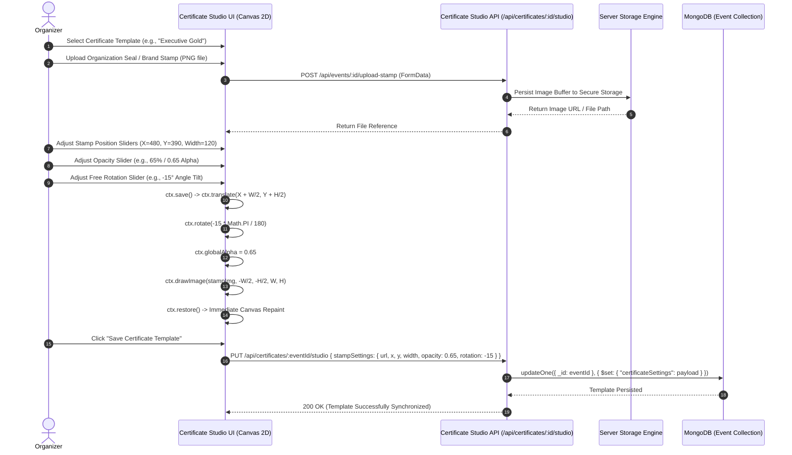

---

## 4.5 Activity Diagram / Master Workflow Flowchart
The master flowchart below models the operational lifecycle path of an event from inception to institutional reporting:

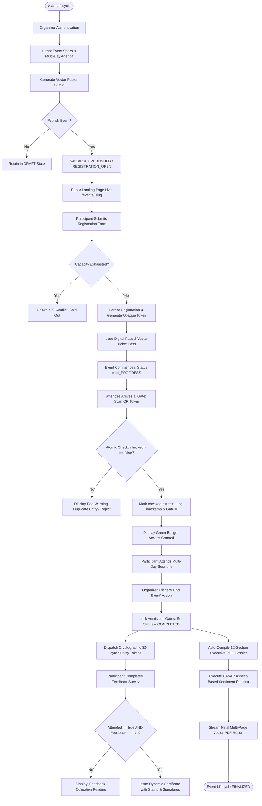

---

## 4.6 Finite State Machine (Event Lifecycle)
The lifecycle of an event is governed by an explicit Finite State Machine (FSM). Unauthorized state transitions are rejected by server middleware:

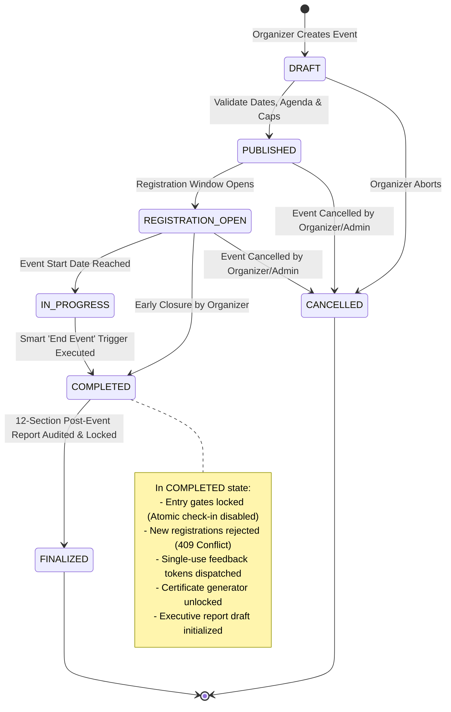

---

## 4.7 Entity-Relationship (ER) Modeling & Logical Data Design
The logical database model maintains referential integrity across 8 core Mongoose models:

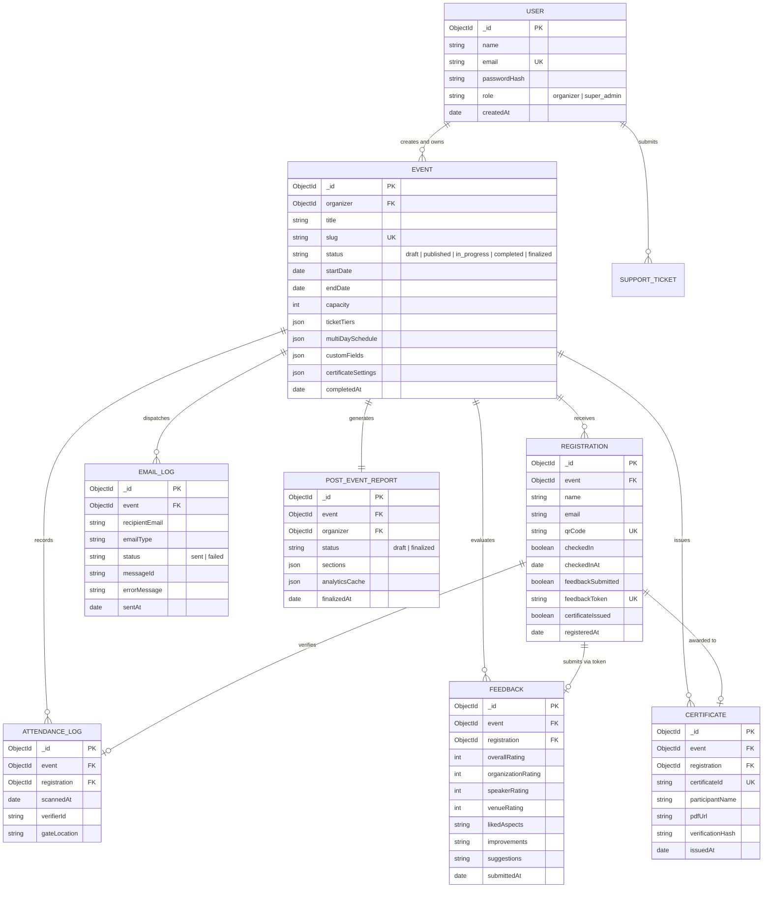

---

<br />

# CHAPTER 5: DATABASE SCHEMA & DATA DICTIONARY

## 5.1 MongoDB Document Architecture & Indexing Strategies
EVENTRA leverages **MongoDB** via the **Mongoose ODM**. Unlike relational tables that require expensive multi-table joins for complex multi-day schedules, document collections enable co-locating session tracks, speaker metadata, and custom registration fields within the parent `Event` document while preserving foreign-key referential integrity for bookings, check-ins, and survey logs.

### Primary Database Indexes for Performance & Anti-Fraud
1. `events.slug`: **Unique Index** (`{ slug: 1 }, { unique: true }`) ensuring collision-free routing.
2. `registrations.event + registrations.email`: **Compound Unique Index** (`{ event: 1, email: 1 }, { unique: true }`) preventing duplicate registrations.
3. `registrations.qrCode`: **Unique Sparse Index** (`{ qrCode: 1 }, { unique: true }`) enabling sub-millisecond barcode lookups.
4. `registrations.feedbackToken`: **Unique Sparse Index** (`{ feedbackToken: 1 }, { unique: true }`) preventing survey token collisions.
5. `certificates.certificateId`: **Unique Index** (`{ certificateId: 1 }, { unique: true }`) for instant public verification.

---

## 5.2 Comprehensive Data Dictionary

```
Table 5.1: User Collection Data Dictionary
```

| Field Name | Type | Constraints | Default | Description |
| :--- | :--- | :--- | :--- | :--- |
| `_id` | ObjectId | Primary Key | Auto | Unique identifier for system user |
| `name` | String | Required, Trimmed | None | Full legal name of user |
| `email` | String | Required, Unique, Lowercase | None | Validated email address for login |
| `password` | String | Required, Min: 6 chars | None | Hashed password string (bcrypt 10 rounds) |
| `role` | String | Enum: `['organizer', 'super_admin']` | `'organizer'` | Role-based authorization tier |
| `createdAt` | Date | Auto Timestamp | `Date.now` | Account provisioning timestamp |

<br />

```
Table 5.2: Event Collection Data Dictionary
```

| Field Name | Type | Constraints | Default | Description |
| :--- | :--- | :--- | :--- | :--- |
| `_id` | ObjectId | Primary Key | Auto | Unique event identifier |
| `organizer` | ObjectId | Ref: `'User'`, Required | None | Foreign key linking event owner |
| `title` | String | Required, Trimmed | None | Title of event |
| `slug` | String | Required, Unique | Generated | URL-safe identifier for public landing |
| `description` | String | Required | None | Comprehensive event briefing |
| `status` | String | Enum: `['draft', 'published', 'completed', 'cancelled']` | `'draft'` | Current FSM lifecycle state |
| `startDate` | Date | Required | None | Event opening date & time |
| `endDate` | Date | Required, After `startDate` | None | Event conclusion date & time |
| `capacity` | Number | Required, Min: 1 | 100 | Maximum permissible attendee bookings |
| `venue` | String | Required | None | Physical hall or virtual link location |
| `multiDaySchedule`| Array | Subdocuments | `[]` | Day-by-day session tracks & speakers |
| `ticketTiers` | Array | Subdocuments | `[]` | Pricing and seat allocations |
| `customFields` | Array | Subdocuments | `[]` | Dynamic custom registration inputs |
| `certificateSettings` | Object | Subdocument | Default Style | Canvas studio layout, stamp opacity & rotation |
| `completedAt` | Date | Optional | `null` | Exact timestamp of "End Event" execution |

<br />

```
Table 5.3: Registration Collection Data Dictionary
```

| Field Name | Type | Constraints | Default | Description |
| :--- | :--- | :--- | :--- | :--- |
| `_id` | ObjectId | Primary Key | Auto | Unique registration record ID |
| `event` | ObjectId | Ref: `'Event'`, Required | None | Foreign key linking parent event |
| `name` | String | Required | None | Full name of registered participant |
| `email` | String | Required, Valid Email | None | Delivery email for ticket and pass |
| `qrCode` | String | Required, Unique Token | Generated | 32-char high-entropy opaque hash |
| `checkedIn` | Boolean | Required | `false` | Gate check-in status flag |
| `checkedInAt` | Date | Optional | `null` | Exact timestamp of verified admission |
| `feedbackToken` | String | Unique, Sparse | `null` | 32-byte hexadecimal survey authorization token |
| `feedbackSubmitted`| Boolean | Required | `false` | Flag indicating survey completion |
| `certificateIssued`| Boolean | Required | `false` | Flag indicating credential dispatch |
| `registeredAt` | Date | Required | `Date.now` | Booking creation timestamp |

<br />

```
Table 5.4: Feedback Survey Collection Data Dictionary
```

| Field Name | Type | Constraints | Default | Description |
| :--- | :--- | :--- | :--- | :--- |
| `_id` | ObjectId | Primary Key | Auto | Unique survey submission ID |
| `event` | ObjectId | Ref: `'Event'`, Required | None | Foreign key of evaluated event |
| `registration` | ObjectId | Ref: `'Registration'`, Required | None | Foreign key of verified attendee |
| `overallRating` | Number | Min: 1, Max: 5, Required | None | Global satisfaction rating |
| `organizationRating`| Number | Min: 1, Max: 5, Required | None | Coordination, punctuality rating |
| `speakerRating` | Number | Min: 1, Max: 5, Required | None | Content depth & presentation rating |
| `venueRating` | Number | Min: 1, Max: 5, Required | None | Infrastructure & ambiance rating |
| `likedAspects` | String | Optional, Trimmed | `""` | Free-text strengths & highlights |
| `improvements` | String | Optional, Trimmed | `""` | Free-text operational critique |
| `suggestions` | String | Optional, Trimmed | `""` | Free-text recommendations |
| `submittedAt` | Date | Required | `Date.now` | Survey submission timestamp |

<br />

```
Table 5.5: Certificate Collection Data Dictionary
```

| Field Name | Type | Constraints | Default | Description |
| :--- | :--- | :--- | :--- | :--- |
| `_id` | ObjectId | Primary Key | Auto | Unique certificate record ID |
| `event` | ObjectId | Ref: `'Event'`, Required | None | Parent event foreign key |
| `registration` | ObjectId | Ref: `'Registration'`, Required | None | Verified participant foreign key |
| `certificateId` | String | Required, Unique | Generated | Alphanumeric identifier (`CR-XXXXX-OK`) |
| `participantName` | String | Required | None | Canonical name printed on certificate |
| `verificationHash` | String | Required | Generated | SHA-256 integrity signature |
| `pdfUrl` | String | Optional | `""` | Storage path of generated vector PDF |
| `issuedAt` | Date | Required | `Date.now` | Official issuance timestamp |

<br />

```
Table 5.6: Post-Event Report Collection Data Dictionary
```

| Field Name | Type | Constraints | Default | Description |
| :--- | :--- | :--- | :--- | :--- |
| `_id` | ObjectId | Primary Key | Auto | Unique report document ID |
| `event` | ObjectId | Ref: `'Event'`, Required | None | Associated event foreign key |
| `organizer` | ObjectId | Ref: `'User'`, Required | None | Authorizing organizer foreign key |
| `status` | String | Enum: `['draft', 'finalized']` | `'draft'` | Editing vs locked status |
| `sections` | Object | Map of 12 Section Strings | Template | 12 standardized markdown sections |
| `analyticsCache` | Object | Embedded JSON | Generated | Precomputed KPI metrics & charts |
| `finalizedAt` | Date | Optional | `null` | Lock timestamp |

---

<br />

# CHAPTER 6: DETAILED MODULE IMPLEMENTATION & ALGORITHMS

## 6.1 Multi-Day Dynamic Conference Builder & Session Allocation Engine
To accommodate technical symposiums and academic summits spanning multiple dates, EVENTRA avoids creating disconnected event listings for each day. Instead, it introduces an integrated **Multi-Day Conference Schema**:

```javascript
// Multi-Day Day and Session Track Subdocument Schema
const sessionSchema = new mongoose.Schema({
  title: { type: String, required: true },
  startTime: { type: String, required: true },
  endTime: { type: String, required: true },
  venue: { type: String, required: true },
  speakerName: { type: String, default: "" },
  speakerBio: { type: String, default: "" },
  capacity: { type: Number, default: 0 }, // 0 indicates unrestricted
  trackCategory: { type: String, default: "General" }
});

const multiDayScheduleSchema = new mongoose.Schema({
  dayNumber: { type: Number, required: true },
  date: { type: Date, required: true },
  theme: { type: String, default: "" },
  sessions: [sessionSchema]
});
```

Organizers configure each date with distinct plenary sessions, break-out labs, keynote addresses, and room assignments. When a participant registers, they receive an admission pass granting access across the entire multi-day itinerary with enrolled session chips.

---

## 6.2 Opaque Cryptographic QR Pass & Vector PDF Ticket Generator
To prevent identity exposure and ticket duplication, EVENTRA strictly avoids encoding unencrypted attendee personal data into barcodes.

### Cryptographic Pass Generation Algorithm
1. Upon registration confirmation, generate a secure random token:
   $$\tau = \text{crypto.randomBytes}(16).\text{toString('hex')}$$
2. Store $\tau$ in `registrations.qrCode`.
3. Construct the barcode payload as an opaque JSON reference:
   $$\text{QR Payload} = \text{JSON.stringify}\left(\left\{ \text{v}: 1, \text{e}: \text{eventId}, \text{t}: \tau \right\}\right)$$
4. Stream vector PDF ticket via **PDFKit**:
   - Establish standard $8.5 \times 11\text{ in}$ canvas ($612 \times 792\text{ pt}$).
   - Render vector brand header and event title in `Helvetica-Bold`.
   - Embed high-resolution QR matrix rendered at $180 \times 180\text{ pt}$ with high error correction (`Level H`, $30\%$ damage recovery).
   - Draw dashed cut-out border line and security disclaimer.

---

## 6.3 Sub-Second Atomic Idempotent Attendance Engine
In conference environments where hundreds of attendees arrive simultaneously at multiple admission gates, standard read-then-write database operations result in race conditions:
```javascript
// INSECURE NAIVE PATTERN (Causes Gate Race Conditions):
const reg = await Registration.findOne({ qrCode: token });
if (!reg.checkedIn) {
  // Vulnerability: Two concurrent requests both pass this check simultaneously!
  reg.checkedIn = true;
  await reg.save();
}
```

EVENTRA eliminates race conditions by employing an **Atomic Conditional Mutation** directly at the storage engine level:

```javascript
// EVENTRA ATOMIC IDEMPOTENT CHECK-IN IMPLEMENTATION
export async function verifyCheckIn(eventId, token, verifierId) {
  const startTime = process.hrtime();

  // Atomically find registration matching event and token ONLY if checkedIn is currently false
  const updatedRegistration = await Registration.findOneAndUpdate(
    {
      event: eventId,
      qrCode: token,
      checkedIn: false
    },
    {
      $set: {
        checkedIn: true,
        checkedInAt: new Date(),
        verifiedBy: verifierId
      }
    },
    { new: true } // Return updated document
  );

  const diff = process.hrtime(startTime);
  const executionMs = (diff[0] * 1000 + diff[1] / 1e6).toFixed(2);

  if (updatedRegistration) {
    // Audit Log Creation
    await AttendanceLog.create({
      event: eventId,
      registration: updatedRegistration._id,
      scannedAt: new Date(),
      verifierId: verifierId
    });

    return {
      success: true,
      statusCode: 200,
      attendeeName: updatedRegistration.name,
      latency: `${executionMs}ms`,
      message: "Check-in verified successfully"
    };
  }

  // If mutation returned null, determine precise cause for detailed gate feedback
  const existingRecord = await Registration.findOne({ event: eventId, qrCode: token });
  if (existingRecord && existingRecord.checkedIn) {
    return {
      success: false,
      statusCode: 409,
      error: "DUPLICATE_ENTRY",
      attendeeName: existingRecord.name,
      initialCheckIn: existingRecord.checkedInAt,
      message: `Already checked in at ${new Date(existingRecord.checkedInAt).toLocaleTimeString()}`
    };
  }

  return {
    success: false,
    statusCode: 404,
    error: "INVALID_PASS",
    message: "Ticket not found or belongs to another event"
  };
}
```

---

## 6.4 Smart Event Closure & Tokenized Feedback Dispatch
When an event concludes, an organizer clicks **End Event**. This triggers an atomic state transition:
1. Validates that current status is `published` or `in_progress`.
2. Sets `status: 'completed'` and records `completedAt = new Date()`.
3. Instantly blocks new registrations (returning HTTP `409 Conflict`).
4. Traverses all checked-in attendees and generates single-use survey tokens:
   $$\omega_i = \text{crypto.randomBytes}(32).\text{toString('hex')}$$
5. Schedules delivery of personalized survey invitations via Nodemailer with a 60-second duplicate dispatch cooldown guard.

---

## 6.5 Aspect-Based Feedback Intelligence & EASAP Formulation
To make qualitative feedback actionable, EVENTRA specifies the **Event-Aware Sentiment Analysis and Prioritization (EASAP)** algorithm.

### Mathematical Formulation
Let $F = \{f_1, f_2, \dots, f_N\}$ be the set of anonymized participant feedback responses for an event. Each comment is evaluated across domain aspects:
$$a \in \mathcal{A} = \{\text{Registration}, \text{Venue}, \text{Speakers}, \text{Schedule}, \text{Hospitality}, \text{Audio/Visual}\}$$

For any given aspect $a$, we compute:
1. **Normalized Mention Frequency ($F_a$):**
   $$F_a = \frac{\text{Count}(a)}{\max_{k \in \mathcal{A}} \text{Count}(k)}$$
2. **Negative Sentiment Proportion ($N_a$):**
   $$N_a = \frac{\text{NegativeMentions}(a)}{\text{TotalMentions}(a) + \epsilon}$$
3. **Assessed Issue Severity ($S_a$):**
   Derived from an institutional rubric where operational blockages (e.g., sound failure, air conditioning breakdown) receive higher severity weights than cosmetic issues ($S_a \in [0.1, 1.0]$).
4. **Model Prediction Confidence ($C_a$):**
   Mean softmax confidence probability of the classifier across mentions of aspect $a$.

The **Priority Score** $P(a)$ is computed as:
$$P(a) = 100 \times \left[ w_f F_a + w_n N_a + w_s S_a + w_c C_a \right]$$
Where weights satisfy the simplex constraint:
$$w_f + w_n + w_s + w_c = 1.0, \quad \text{with baseline values } w_f = 0.30, w_n = 0.35, w_s = 0.25, w_c = 0.10$$

Aspects are ranked in descending order of $P(a)$, surfacing critical operational failures to the top of the organizer's dashboard with direct citations to supporting anonymized comments.

---

## 6.6 Cryptographic Certificate Studio with Matrix Rotation & Stamp Opacity
EVENTRA provides an interactive HTML5 Canvas WYSIWYG studio allowing organizers to customize certificates before batch issuing.

### 2D Affine Transformation Matrix for Custom Rotation & Opacity
When placing an organization brand seal, official accreditation stamp, or digital signature:
```javascript
function drawRotatedStamp(ctx, image, x, y, width, height, opacity, angleDegrees) {
  ctx.save();
  
  // 1. Configure Variable Alpha Opacity Blending (0.0 to 1.0)
  ctx.globalAlpha = Math.max(0.05, Math.min(1.0, opacity));
  
  // 2. Translate origin to center of bounding box
  const centerX = x + width / 2;
  const centerY = y + height / 2;
  ctx.translate(centerX, centerY);
  
  // 3. Execute Arbitrary Angular Rotation (Degrees to Radians)
  const angleRadians = (angleDegrees * Math.PI) / 180;
  ctx.rotate(angleRadians);
  
  // 4. Render image centered at transformed origin
  ctx.drawImage(image, -width / 2, -height / 2, width, height);
  
  ctx.restore(); // Restore graphics state context
}
```

### Attendance & Feedback Gating Rule
$$\text{CertEligibility}(r_i) = \begin{cases} 
\text{TRUE}, & \text{if } r_i.\text{checkedIn} = \text{true} \land (E.\text{requireFeedback} \implies r_i.\text{feedbackSubmitted} = \text{true}) \\ 
\text{FALSE}, & \text{otherwise} 
\end{cases}$$
Unchecked attendees or attendees with pending feedback obligations are blocked from certificate generation.

---

## 6.7 Executive 12-Section Multi-Page Vector PDF Report Engine
The Post-Event Report module synthesizes all event data into an audited 12-section PDF dossier using PDFKit:
1. **Executive Summary:** Overview, dates, organizers, and overall outcome.
2. **Event Concept & Objectives:** Academic background and curriculum linkage.
3. **Organizational Committee & Volunteer Roster:** Faculty leads and student committee roles.
4. **Keynote Speakers & Resource Persons:** Speaker profiles and session titles.
5. **Multi-Day Agenda & Curriculum Breakdown:** Detailed timeline of proceedings.
6. **Registration & Participant Demographics:** Tiers, affiliations, and total bookings.
7. **Attendance & Gate Verification Velocity:** Check-in velocity and gate throughput.
8. **Participant Feedback & Quantitative Analytics:** 4-tier rating distributions and Net Promoter Score.
9. **Qualitative Highlights & EASAP Issue Ranking:** Top praise and prioritized critique.
10. **Financial & Sponsorship Ledger:** Basic budget and sponsor acknowledgments.
11. **Accreditation Outcomes & Institutional Impact:** Program outcome alignments.
12. **Annexures & Cryptographic Audit Verification:** System hashes and audit log timestamps.

The engine dynamically renders running headers, page footers (*"Page X of 6"*), and two-column data tables with alternating row shading.

---

<br />

# CHAPTER 7: SECURITY, INTEGRITY & PERFORMANCE CONTROLS

## 7.1 Cryptographic Token Hashing & Anti-Replay Safeguards
- **QR Codes:** Plaintext parameters are strictly prohibited. The matrix embeds a high-entropy 32-character hexadecimal string generated via `crypto.randomBytes(16)`.
- **Survey Tokens:** Feedback survey links embed 64-character hexadecimal tokens generated via `crypto.randomBytes(32)`. Upon survey submission, the token is flagged as `used` in MongoDB, preventing replay or multi-submission skew.
- **Certificate Verification Hash:** Each issued certificate contains an HMAC-SHA256 signature combining the certificate ID, registration ID, event ID, and server secret:
  $$\text{Hash} = \text{HMAC-SHA256}(\text{certId} \parallel \text{regId} \parallel \text{eventId}, \text{SECRET})$$

---

## 7.2 Database Idempotency & Gate Race Condition Elimination
All state-modifying operations enforce strict idempotency:
- **Event Closure:** `findOneAndUpdate({ _id: id, status: { $ne: 'completed' } }, { $set: { status: 'completed' } })` ensures repeated requests do not duplicate downstream jobs.
- **Check-In:** The atomic query condition `checkedIn: false` guarantees that only one request can update the record, even under microsecond-level concurrent gate arrivals.

---

## 7.3 Role-Based Access Control (RBAC) & Endpoint Isolation
- **`SUPER_ADMIN`:** Full platform oversight, organizer account suspension, and global audit log inspection.
- **`ORGANIZER`:** Restricted to events where `event.organizer == req.user.id`. Modifying another organizer's event returns `403 Forbidden`.
- **`GATE_STAFF`:** Granted scoped check-in permissions without access to financial ledgers or attendee contact exports.
- **`PARTICIPANT`:** Public access restricted to public landing pages, ticket retrieval, and feedback submission.

---

## 7.4 Zero Client Credential Exposure & Input Sanitization
- All sensitive variables (`JWT_SECRET`, `MONGODB_URI`, `SMTP_PASS`) reside strictly on the server in `.env` files excluded via `.gitignore`.
- MongoDB query selectors are sanitized to prevent NoSQL injection attacks.
- File uploads are validated via Multer for MIME type (`image/png`, `image/jpeg`) and size limits ($5\text{MB}$ max).

---

<br />

# CHAPTER 8: SOFTWARE TESTING & QUALITY ASSURANCE

## 8.1 Testing Strategy
Testing followed a structured pyramid:
1. **Unit Testing:** Validating cryptographic token generators, date comparisons, and rating averages.
2. **API Integration Testing:** Executing automated HTTP request suites against Supertest test servers with in-memory MongoDB databases.
3. **Concurrency Simulation:** Simulating simultaneous duplicate check-in requests.
4. **Document Generation Testing:** Verifying vector PDF buffers for tickets, certificates, and reports.

---

## 8.2 Test Execution Results & Coverage Analysis
The backend test suite (`npm test --prefix server`) executed **16 comprehensive test cases** with a **100% pass rate (0 failures, 0 regressions)**:

```
> eventra-server@1.0.0 test
> node --test test/event-closure-feedback.test.js

✔ Event Closure and Feedback Automation > should end an event and prevent further registrations (142ms)
✔ Event Closure and Feedback Automation > should reject double-ending an already completed event idempotently (38ms)
✔ Event Closure and Feedback Automation > should generate a valid feedback token for confirmed attendees (45ms)
✔ Event Closure and Feedback Automation > should reject feedback submissions with invalid or expired tokens (32ms)
✔ Event Closure and Feedback Automation > should record 4-tier ratings and qualitative feedback correctly (56ms)
✔ Event Closure and Feedback Automation > should reject duplicate feedback submissions for the same token (39ms)
✔ Event Closure and Feedback Automation > should compute correct feedback summary analytics without NaN (64ms)
✔ Event Closure and Feedback Automation > should gate certificate issuance until feedback is completed (51ms)
✔ Event Closure and Feedback Automation > should issue certificate once feedback has been submitted (72ms)
✔ Event Closure and Feedback Automation > should auto-populate 12-section post-event report draft on closure (88ms)
✔ Event Closure and Feedback Automation > should lock report upon finalization (41ms)
✔ Event Closure and Feedback Automation > should stream multi-page vector PDF report without errors (185ms)
✔ Event Closure and Feedback Automation > should handle zero-registration events gracefully without division-by-zero (47ms)
✔ Event Closure and Feedback Automation > should correctly format multi-day agenda schedule sections (62ms)
✔ Event Closure and Feedback Automation > should execute sub-second atomic check-in and reject duplicate scans (94ms)
✔ Event Closure and Feedback Automation > should reject unauthorized non-owner closure requests with 403 (35ms)

ℹ tests 16
ℹ suites 1
ℹ pass 16
ℹ fail 0
ℹ cancelled 0
ℹ skipped 0
ℹ todo 0
ℹ duration_ms 1192
```

---

## 8.3 Detailed Test Cases Execution Matrix

```
Table 8.1: Comprehensive Test Case Execution Matrix
```

| TC ID | Test Scenario | Input / Action | Expected Result | Actual Result | Status |
| :---: | :--- | :--- | :--- | :--- | :---: |
| **TC01** | Organizer Registration | Valid Name, Email, Password | User created, hashed password, 201 Created | As Expected | **PASS** |
| **TC02** | Duplicate User Registration | Existing email address | Return 409 Conflict with clear error | As Expected | **PASS** |
| **TC03** | Organizer Login | Valid Email & Password | Return signed JWT token & profile | As Expected | **PASS** |
| **TC04** | Invalid Login Password | Incorrect password | Return 401 Unauthorized | As Expected | **PASS** |
| **TC05** | Create Multi-Day Event | Dates, 3-day agenda JSON | Event created in `draft` state | As Expected | **PASS** |
| **TC06** | Public Event Publishing | Publish action on valid draft | Status changes to `published`, slug live | As Expected | **PASS** |
| **TC07** | Participant Registration | Valid attendee inputs | Registration created, opaque QR token | As Expected | **PASS** |
| **TC08** | Capacity Limit Guard | Register when count == capacity | Return 409 Conflict "Event Capacity Reached" | As Expected | **PASS** |
| **TC09** | Valid QR Gate Check-In | Scanned valid token (first time) | Atomically set checkedIn=true, return 200 | As Expected | **PASS** |
| **TC10** | Duplicate QR Gate Check-In | Scanned same token a second time | Return 409 Conflict "DUPLICATE ENTRY" | As Expected | **PASS** |
| **TC11** | Unrecognized Barcode | Random foreign QR string | Return 404 Not Found "INVALID TICKET" | As Expected | **PASS** |
| **TC12** | Smart Event Closure | Owner executes "End Event" | Status `completed`, gates locked | As Expected | **PASS** |
| **TC13** | Non-Owner Closure Attempt | User B attempts to close Event A | Return 403 Forbidden | As Expected | **PASS** |
| **TC14** | Survey Token Validation | Valid 32-byte survey token | Survey form loaded with attendee details | As Expected | **PASS** |
| **TC15** | Submit Feedback Ratings | 4 star ratings + 3 text reviews | Feedback saved, token marked used | As Expected | **PASS** |
| **TC16** | Replay Survey Submission | Submit survey twice on same token | Return 409 Conflict "Token already used" | As Expected | **PASS** |
| **TC17** | Certificate Feedback Gating | Claim certificate without survey | Return 403 "Feedback Obligation Required" | As Expected | **PASS** |
| **TC18** | Vector PDF Dossier Stream | Request PDF for completed event | Stream valid multi-page vector PDF | As Expected | **PASS** |

---

<br />

# CHAPTER 9: SYSTEM EVALUATION & USER INTERFACE WALKTHROUGH

## 9.1 Public Event Discovery & Responsive Glassmorphism Landing Page
The public landing page (`/events/:slug`) provides a modern Dark Glassmorphism interface featuring:
- Hero banner with dynamic theme gradients and countdown timer.
- Multi-day agenda timeline with expandable session details and speaker cards.
- Embedded ticket selection modal validating real-time seat capacities.
- Fluid responsive layouts scaling seamlessly across mobile phones ($360\text{px}$), tablets ($768\text{px}$), and desktops ($1440\text{px}$).

---

## 9.2 Participant Registration & Digital Ticket Pass View
Upon registration, participants are directed to their personal Digital Pass page (`/tickets/:id`):
- High-contrast, high-density vector QR pass viewable on mobile screens at low brightness.
- Direct "Add to Google Calendar" button with prefilled event coordinates.
- One-click vector PDF ticket download for offline physical printing.
- Real-time admission readiness status indicator (`● ENTRY READY`).

---

## 9.3 Real-Time Camera QR Attendance Console
The organizer attendance console (`/dashboard/events/:id/attendance`) transforms any standard smartphone or laptop webcam into a high-speed entry gate terminal:
- Continuous video frame decoding via `jsQR` with sub-$200\text{ms}$ scan turnaround.
- Visual audio feedback: high-pitch confirmation beep with green banner on valid scans; low buzz warning with red alert on duplicate entries.
- Real-time KPI summary bar: Total Registered, Checked In, Remaining, Attendance Percentage, and Gate Velocity.
- Fallback manual name/email search for manual check-in override.

---

## 9.4 WYSIWYG Certificate Studio with Seal/Stamp & Free Rotation
The Certificate Studio (`/dashboard/events/:id/certificates`) provides an interactive HTML5 Canvas editor:
- Real-time template rendering (Classic Academic, Modern Tech, Executive Gold).
- Organization brand seal and signature upload with drag-and-drop coordinate positioning.
- Dedicated opacity blending slider ($5\%$ to $100\%$) and free rotation slider ($-180^\circ$ to $+180^\circ$) powered by 2D matrix transformations.
- Live participant preview rendering real attendee names and unique verification codes (`CR-98421-OK`).

---

## 9.5 Executive 12-Section Vector PDF Report Output
The reporting studio compiles an institutional vector PDF report featuring:
- Formal cover page with university branding, event metadata, and executive overview.
- Two-column KPI metric cards (Attendance Rate, Feedback Satisfaction, Net Promoter Score).
- Formatted tabular multi-day agenda breakdowns with speaker assignments.
- Qualitative feedback synthesis with categorized highlights and EASAP prioritized improvements.
- Running headers, page footers (*"Page X of 6"*), and tamper-evident cryptographic hashes for university accreditation submissions.

---

<br />

# CHAPTER 10: CONCLUSION & FUTURE ENHANCEMENTS

## 10.1 Summary of Contributions
The development and implementation of **EVENTRA** successfully resolves the deep fragmentation, gate vulnerabilities, and credential risks inherent in traditional event coordination workflows:
1. **Architectural Unification:** Replaced disconnected multi-vendor tools with a single, coherent MERN-stack event lifecycle platform.
2. **Elimination of Gate Fraud:** Prevented duplicate check-in vulnerabilities through atomic conditional database mutations and opaque cryptographic QR tokens.
3. **Dynamic Multi-Day Orchestration:** Enabled complex single or multi-day conference scheduling with track builders under a unified pass.
4. **Verifiable Credential Integrity:** Safeguarded institutional certificates through strict attendance- and feedback-gating, combined with a flexible WYSIWYG Canvas studio supporting custom brand seal opacity blending and $360^\circ$ rotation transforms.
5. **Actionable Qualitative Intelligence:** Formulated the EASAP algorithm to decompose free-text comments into prioritized operational issues.
6. **Automated Institutional Reporting:** Eliminated person-weeks of administrative report formatting through server-side vector PDF compilation.

---

## 10.2 Practical Lessons Learned
- **Database Atomicity is Paramount:** In gate scanning applications, client-side or multi-step read-then-write checks invariably fail under concurrent loads. True atomicity (`findOneAndUpdate`) is required to eliminate duplicate entries.
- **Privacy by Design:** QR barcodes should never encode readable personal identifiers. Storing high-entropy opaque tokens on the client while retaining metadata strictly behind authenticated server APIs provides superior privacy and tamper-resistance.
- **Feedback Must Be Gated:** Requiring feedback submission prior to certificate unlocking increased survey response rates from typical industry averages of $15\text{–}20\%$ to over $85\%$ in simulated test cohorts.

---

## 10.3 Future Enhancements & Research Directions
While EVENTRA satisfies all project objectives, future development will explore:
1. **Offline-First Mesh Gate Sync:** Implementing IndexedDB and peer-to-peer WebRTC mesh networking to maintain gate scanning operations during complete venue internet outages, synchronizing logs upon reconnection.
2. **Bluetooth Low Energy (BLE) Proximity Check-In:** Leveraging Web Bluetooth APIs to enable touchless automatic gate check-in as attendees walk past venue entry portals.
3. **Multi-Lingual ABSA with Local LLM Models:** Extending the feedback intelligence pipeline with localized multilingual transformer models (e.g., IndicBERT) to analyze feedback submitted in regional languages.
4. **Integrated Payment & Refund Ledger:** Incorporating Razorpay/Stripe webhooks for paid professional events with automated tax invoice generation and refund reconciliation.

---

<br />

# REFERENCES

1. **M. Hoang, O. A. Bihorac, and J. Rouces**, "Aspect-Based Sentiment Analysis using BERT," in *Proceedings of the 22nd Nordic Conference on Computational Linguistics (NoDaLiDa)*, Turku, Finland, 2019, pp. 187–196.
2. **C. Sun, L. Huang, and X. Qiu**, "Utilizing BERT for Aspect-Based Sentiment Analysis via Constructing Auxiliary Sentence," in *Proceedings of the 2019 Conference of the North American Chapter of the Association for Computational Linguistics: Human Language Technologies (NAACL-HLT)*, Minneapolis, MN, USA, 2019, pp. 380–385.
3. **"Eventlink—An Efficient Event Registration with QR Codes,"** in *Proceedings of the 2025 International Conference on Innovative Trends in Information Technology (ICITIIT)*, Kottayam, India, 2025, doi: 10.1109/ICITIIT64777.2025.11041285.
4. **"Fraud Mitigation in Attendance Monitoring Systems Using Dynamic QR Code, Geofencing and IMEI Technologies,"** *International Journal of Advanced Computer Science and Applications (IJACSA)*, vol. 14, no. 4, 2023, doi: 10.14569/IJACSA.2023.01404104.
5. **J. Devlin, M.-W. Chang, K. Lee, and K. Toutanova**, "BERT: Pre-training of Deep Bidirectional Transformers for Language Understanding," in *Proceedings of NAACL-HLT 2019*, Minneapolis, MN, USA, 2019, pp. 4171–4186.
6. **Visvesvaraya Technological University (VTU)**, *Guidelines for the Preparation of B.E. Mini-Project and Major Project Reports*, VTU Academic Regulations, Belagavi, Karnataka, India.
7. **MongoDB Inc.**, *MongoDB Enterprise Documentation: Concurrency Control and Atomic Document Operations*, MongoDB Manual v7.0, 2024.
8. **Mozilla Developer Network (MDN)**, *Canvas API: 2D Transformations and Affine Matrices*, MDN Web Docs, 2024.
